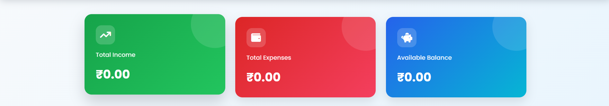

# Expense Tracker - Personal Finance Dashboard


A web-based Expense Tracker that helps users manage their personal finances by tracking income, expenses, and available balance.


## Project Screenshot





## Features


- Add income and expense transactions.

- Edit existing transactions.

- Delete transactions.

- View total income, expenses, and available balance.

- Category-wise expense visualization.

- Interactive dashboard.

- Responsive design for desktop and mobile devices.


## Technologies Used


### Frontend


- HTML

- CSS

- JavaScript

- Chart.js


### Backend


- Python

- FastAPI

- SQLite


## Project Structure


```text
ExpenseTracker/
    backend/
    frontend/
    screenshots/
        dashboard.png.png
    README.md
```


## How to Run


### Backend


```powershell

uvicorn expense_app:app --reload

```


### Frontend


```powershell

python -m http.server 5502

```


Open `http://localhost:5502/expense.html`.


## Project Goal


To provide a simple and user-friendly platform for tracking personal income and expenses.


